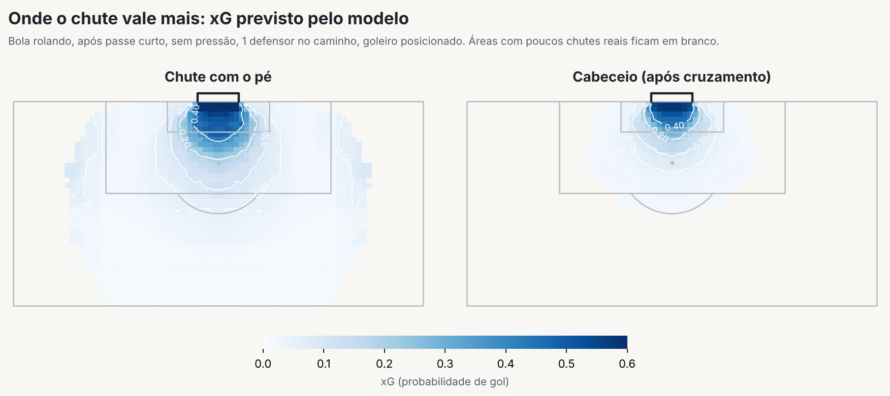
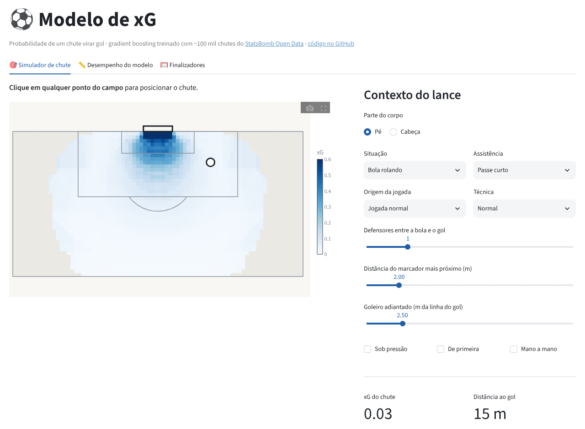
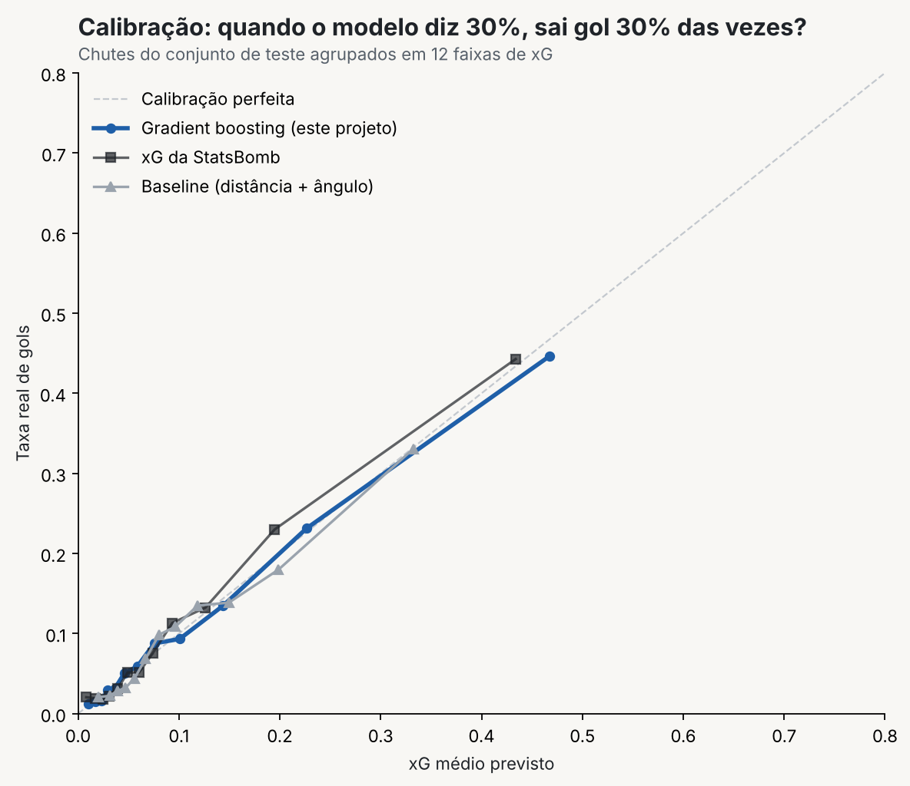
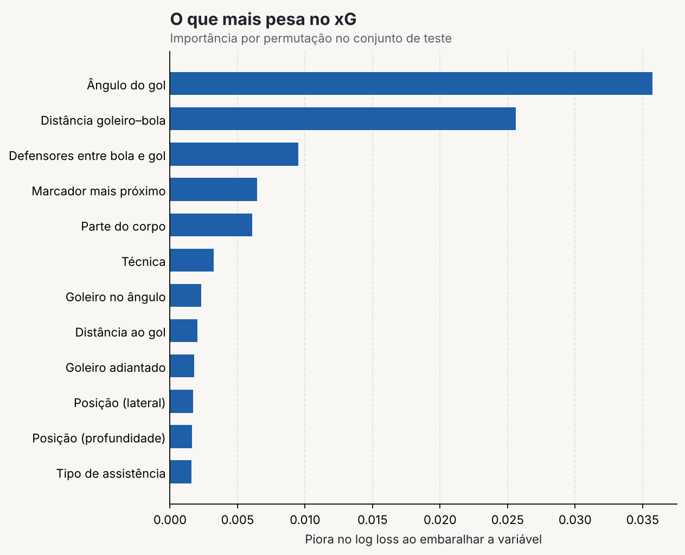
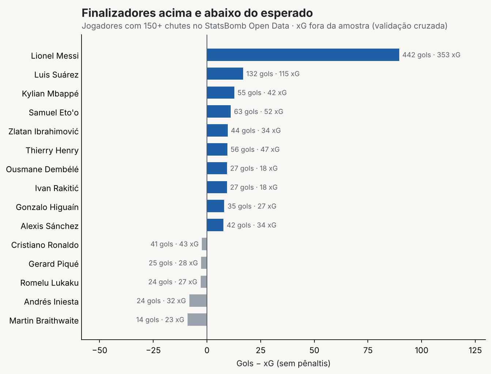

# ⚽ Modelo de xG (Expected Goals) com Machine Learning

[](https://modelo-xg.streamlit.app)

> Qual a probabilidade de um chute virar gol? Um modelo de **gradient boosting** treinado com **~100 mil chutes** que chega ao nível do xG oficial da StatsBomb.



## 🖥️ App interativo

**👉 [modelo-xg.streamlit.app](https://modelo-xg.streamlit.app)**: clique em qualquer ponto do campo, ajuste o contexto do lance (parte do corpo, assistência, defensores no caminho, posição do goleiro...) e veja o xG do chute.



## Dados

- **Fonte:** [StatsBomb Open Data](https://github.com/statsbomb/open-data), com todas as competições disponíveis.
- **Volume:** 99.710 chutes de 3.961 partidas (masculino e feminino), sem pênaltis.
- **Taxa de gol:** 10,3%.

## Variáveis (features)

| Grupo | Variáveis |
|---|---|
| Geometria | distância ao gol, ângulo de abertura do gol, posição |
| Tipo de chute | parte do corpo, técnica (voleio, cobertura...), bola rolando ou falta direta |
| Contexto | origem da jogada, tipo de assistência (enfiada, cruzamento, cruzamento rasteiro...), sob pressão, de primeira, mano a mano |
| **Freeze frame** | defensores entre a bola e o gol, marcador mais próximo, adversários a até 5 m, posição do goleiro |

As variáveis de *freeze frame* vêm da posição de todos os jogadores no momento do chute, extraídas e transformadas com geometria (ex.: quantos defensores estão dentro do triângulo bola-traves).

## Modelos e validação

- Divisão treino/teste **por partida**, para evitar vazamento entre chutes do mesmo jogo.
- **Validação cruzada com 5 folds** agrupados por partida.
- Métricas de probabilidade: **log loss** e **Brier score**, além de **ROC AUC** e calibração.

| Modelo (conjunto de teste) | Log loss ↓ | Brier ↓ | ROC AUC ↑ |
|---|---:|---:|---:|
| Baseline (distância + ângulo) | 0.2888 | 0.0820 | 0.746 |
| Regressão logística (todas as variáveis) | 0.2628 | 0.0745 | 0.805 |
| **Gradient boosting** | **0.2583** | **0.0738** | **0.814** |
| xG da StatsBomb (referência) | 0.2607 | 0.0741 | 0.809 |

Na **validação cruzada (média de 5 folds)**, o gradient boosting obteve log loss de **0.2626** contra **0.2645** da StatsBomb, e AUC de **0.811** contra **0.806**. Isso coloca o modelo **no mesmo nível do xG profissional**.

> A StatsBomb treina seu modelo com uma base muito maior e proprietária. Aqui ela serve de **referência de qualidade**, não de adversária.

<p float="left">
  
  
</p>

## Aplicação: finalizadores acima do esperado

Com as previsões fora da amostra, comparo gols com xG acumulado. **Messi** marcou cerca de **90 gols a mais que o esperado**.



## Como rodar

```bash
git clone https://github.com/andrecasemiro28/modelo-xg.git
cd modelo-xg
pip install -r requirements.txt
streamlit run app.py                 # app (usa data/processed/shots.csv)

# opcional: refazer a base do zero (~3 min) e abrir o notebook
python -m src.extract
pip install jupyter && jupyter notebook notebooks/01_modelo_xg.ipynb
```

## Estrutura

```
├── app.py                         # app Streamlit (simulador de chute)
├── data/processed/shots.csv       # ~100 mil chutes com as features
├── notebooks/01_modelo_xg.ipynb   # análise completa
├── reports/                       # métricas e gráficos
└── src/
    ├── extract.py   # leitura do Open Data + engenharia de features (geometria, freeze frame)
    ├── model.py     # modelos, validação cruzada, cenários e grade de xG
    └── viz.py       # gráficos
```

## Limitações e próximos passos

- O Open Data **não é uma amostra aleatória**: tem muitos jogos do Barcelona da era Messi e algumas competições específicas.
- Em regiões com poucos chutes, o modelo extrapola. O mapa e o app sinalizam essas áreas.
- Próximos passos: XGBoost/LightGBM com busca de hiperparâmetros, calibração isotônica e um modelo de *post-shot xG*.

---

**Autor:** André Casemiro, estudante de Ciência de Dados e IA (IBMEC RJ) · Outro projeto: [Scouting por similaridade](https://github.com/andrecasemiro28/scouting-futebol)
Dados: StatsBomb Open Data, de uso não comercial e com atribuição.
